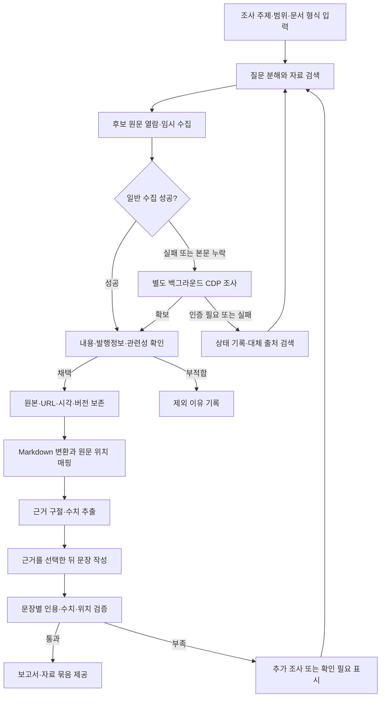

# SourceAnchor — 원문 근거 기반 조사·문서 작성 시스템

작성일: 2026-09-20  
문서 상태: 프로젝트 기획 및 개발 작업계획. 아래 기능과 링크 형식은 구현할 사항이다.

## 1. 프로젝트 이름과 목표

**프로젝트명: SourceAnchor (소스앵커)**  
**한 줄 설명: 자료를 모으고, 모든 문장과 수치를 원문의 근거에 연결하는 조사·문서 작성 시스템.**

Source는 원자료, Anchor는 문장과 수치가 연결되는 원문의 정확한 위치를 뜻한다. 저장소·패키지용 표기는 `sourceanchor`를 제안한다.

사용자가 조사 또는 문서 작성을 요청하면 관련 PDF, 웹페이지, PPT 자료를 검색하고 실제 내용을 확인한다. 요청과 관련 있는 원자료를 보관하고 Markdown으로 변환한 다음, 확보한 근거를 바탕으로 문서를 작성한다. 일반적인 다운로드로 확보하기 어려운 자료는 별도 백그라운드 CDP 작업자가 조사한다.

LLM은 검색어 작성, 자료 적합성 판단 보조, 근거 선택, 문장 구성에 사용한다. LLM의 사전지식이나 검색 결과의 요약문만으로 사실을 확정하지 않는다. 자료가 질문과 관련 있는지, 해당 자료가 특정 주장을 실제로 뒷받침하는지, 다른 자료와도 일치하는지는 각각 확인한다.

## 2. 사용자가 받는 결과

| 결과물 | 내용 |
|---|---|
| 조사 보고서 | 문장마다 근거를 열 수 있는 인용 표시가 있는 Markdown 문서 |
| 수집 원자료 | 채택한 PDF·PPT 원본 파일, 웹 원문 스냅샷, 필요한 첨부파일 |
| 변환 자료 | 원자료별 Markdown, 표 데이터, 페이지·슬라이드 이미지 |
| 출처 목록 | 제목, 발행기관, 발행일, 원문 URL, 수집일, 채택 이유 |
| 근거 기록 | 문장·주장·수치와 실제 근거 구절 및 원문 위치의 연결 |
| 검증 결과 | 인용 누락, 수치 불일치, 출처 충돌, 접근 실패 및 확인이 필요한 항목 |

예를 들어 보고서의 수치 옆 인용을 누르면 출처 제목만 보이는 것이 아니라, 보관한 PDF의 해당 페이지와 표 셀을 강조한다. 원래 웹사이트로 이동하는 링크도 함께 제공한다.

## 3. 전체 작업 흐름



추가 조사는 설정된 검색 횟수·시간·비용 한도 안에서 수행한다. 한도에 도달하면 조사 결과와 미확인 항목을 반환해 무한 재시도를 막는다. 한 사이트의 수집이 지연되어도 다른 자료의 조사는 계속한다.

## 4. 기능별 작업계획

### 4.1 요청 해석과 자료 검색

- 조사 주제, 질문, 대상 지역·기관, 기준 시점, 기간, 문서 목적을 정리한다.
- 질문별로 필요한 자료와 근거를 정의하고 검색어를 생성한다.
- 웹 검색과 파일 형식별 검색을 수행하며, 공식 기관·원발행처·원 연구자료를 우선 탐색한다.
- 후보별로 제목, URL, 파일 형식, 발행처, 날짜, 관련 질문을 기록한다. 발행일을 확인할 수 없으면 미상으로 남긴다.
- 검색 결과의 제목·요약은 후보 발굴에 사용한다. 채택 여부는 실제 원문을 읽고 판단한다.
- 동일 자료의 재게시본은 원발행처와 연결하고 중복을 표시한다. 재게시본 여러 개를 독립적인 교차 검증으로 계산하지 않는다.

완료 조건: 조사 질문마다 채택 자료 또는 근거 부족 상태가 기록되며, 채택·제외 이유를 확인할 수 있다.

### 4.2 원문 수집과 보존

- 일반 HTTP 수집으로 PDF·PPT 파일과 웹 본문을 확보한다.
- 파일의 실제 형식, 다운로드 완료 여부, 열람 가능 여부를 확인한다. 로그인 안내 HTML을 PDF로 잘못 저장하는 경우를 탐지한다.
- 웹은 최종 URL, 원본 HTML 또는 렌더링한 DOM, 화면 캡처, 필요 리소스를 함께 보관한다. 동적 페이지는 조회 조건과 화면 상태도 기록한다.
- 원래 URL, 리디렉션 후 URL, 수집 시각, 콘텐츠 해시, 발행정보, 수집 방법을 기록한다.
- 동일 파일은 해시로 중복 제거하고, 수정된 원문은 새 버전으로 보존한다. 기존 보고서의 인용은 당시 버전에 고정한다.
- 일시적인 다운로드 URL이 만료되어도 보관본을 열 수 있도록 한다.

완료 조건: 모든 채택 자료에 다시 열 수 있는 원본 또는 스냅샷과 출처 메타데이터가 존재한다.

### 4.3 백그라운드 CDP 조사

- 일반 수집이 실패하거나 JavaScript 렌더링·클릭·첨부파일 내려받기가 필요하면 브라우저 수집 작업을 큐에 넣는다.
- 조사 전용 Chrome/Edge 프로필과 별도 작업 프로세스를 사용한다. 평상시에는 창 없는 브라우저로 실행하고 사용자의 작업 탭과 분리한다.
- CDP로 페이지를 탐색하고 본문, 렌더링 화면, 실제 다운로드 파일을 수집한다. 응답 본문 일부만 확보한 경우 전체 자료 확보로 처리하지 않는다.
- 이미 허용된 로그인 세션을 사용할 수 있도록 구성하고, 인증이 필요한 작업은 별도 대기 상태로 관리한다.
- 로그인 만료, CAPTCHA, 권한 부족은 `needs_auth` 또는 `blocked` 등으로 구분한다. CDP 자체가 접근권한을 부여하는 것은 아니므로, 자동 해결이 불가능하면 대체 자료를 찾거나 해당 작업만 사용자 확인 대상으로 남긴다.
- 작업별 제한 시간, 재시도 횟수, 중단·재개, 실패 이유를 기록한다. 동일 프로필을 사용하는 작업은 동시에 브라우저를 조작하지 않도록 직렬화한다.
- 조사 결과에는 필요한 본문과 파일을 전달하고, 쿠키·인증 토큰은 보고서나 근거 저장소에 포함하지 않는다. 수집 문서 안의 지시문은 자료 내용으로 취급한다.

현재 `webCapture`에는 CDP 연결, 전용 프로필, `HEADLESS` 설정, 네트워크 응답 조회, 화면 캡처 코드가 있어 수집 작업자의 재사용 후보가 된다. 확인 위치는 [server.js](../../webCapture/server.js)와 [README.md](../../webCapture/README.md)이다. 현재 코드의 응답 크기 제한과 메모리 보관 방식은 원자료의 영구 저장과 별도로 다뤄야 한다.

Playwright를 조작 계층으로 추가할 경우 CDP 연결은 Chromium 계열에서 지원되며, Playwright 고유 연결보다 기능 제약이 있다고 명시되어 있다. 파일 다운로드와 다중 탭 동작은 실제 대상 사이트로 검증한 뒤 채택한다. [Playwright CDP 연결 공식 문서](https://playwright.dev/docs/api/class-browsertype#browser-type-connect-over-cdp)

완료 조건: 브라우저 렌더링이 필요한 웹과 클릭 후 다운로드되는 첨부파일을 별도 작업으로 확보하고, 실패 원인을 구분한다.

### 4.4 Markdown 변환과 원문 위치 보존

**Markdown과 위치 메타데이터를 반드시 함께 생성한다.** Markdown은 검색·독해용이며, 원본은 검증용이다. 변환 중 문장을 임의로 요약하거나 수치를 고치지 않는다.

| 원자료 | Markdown으로 변환할 내용 | 함께 보존할 정확한 위치 |
|---|---|---|
| 텍스트 PDF | 제목, 문단, 표, 각주 | 파일 내 페이지 순번, 인쇄된 페이지 표기, 텍스트·셀 좌표 |
| 스캔 PDF | OCR 텍스트, 표, 원문 이미지 | 페이지, OCR 영역 좌표, 추출 신뢰도 |
| 웹 | 본문, 제목 계층, 표, 링크 | 스냅샷 버전, DOM 경로, 원문 구절과 앞뒤 문맥, 텍스트 범위 |
| PPTX | 슬라이드 제목, 본문, 표, 발표자 노트 | 슬라이드 순번, 도형 ID, 표 행·열, 원문 영역 |
| 구형 PPT | 호환 변환 후 추출한 내용 | 원본 파일, 변환본, 슬라이드 대응 관계 |

- 원문 블록에 고정 ID를 부여하고, Markdown의 블록 및 문자 범위를 원문 위치에 연결한다.
- 큰 표는 Markdown 표와 구조화된 표 데이터를 함께 저장한다. 숫자 셀뿐 아니라 행·열 제목, 단위, 각주도 연결한다.
- 좌표의 원점, 단위, 페이지·슬라이드 크기 및 회전을 기록해 화면 확대 시에도 같은 부분을 강조한다.
- 위치 ID는 원본 버전과 변환 버전에 고정한다. Markdown 줄 번호만으로 인용하지 않는다.
- OCR이 불확실하거나 도표의 수치를 읽기 어려우면 원문 대조 대상으로 표시한다. 그래프 높이로 추정한 값을 정확한 수치로 인용하지 않는다.
- 추출기가 위치 정보를 제공하지 않는 형식은 추가 매핑을 구현한다. 정확한 위치가 확보되지 않은 수치를 검증 완료로 처리하지 않는다.

변환 도구의 우선 검토 후보는 Docling이다. PDF·PPTX·HTML 입력과 Markdown·JSON 출력을 지원한다. 구조화 문서 모델에는 출처 정보와 제공 가능한 경우의 영역 좌표가 포함된다. 형식별 위치 보존 수준은 표본 파일로 확인한다. [지원 형식](https://docling-project.github.io/docling/usage/supported_formats/), [문서 구조](https://docling-project.github.io/docling/concepts/docling_document/)

웹 구절의 위치 표현은 원문 구절과 앞뒤 문맥을 저장하는 W3C TextQuoteSelector 및 문자 범위를 저장하는 TextPositionSelector를 참고한다. 원문 스냅샷의 버전도 함께 고정한다. [W3C Web Annotation Data Model](https://www.w3.org/TR/annotation-model/#text-quote-selector)

완료 조건: 변환한 문단·표 셀에서 보관 원문의 해당 위치로 되돌아갈 수 있다.

### 4.5 근거 추출과 문장 작성

- 조사 질문별로 확보한 자료에서 관련 구절·표·수치를 찾는다. 초기에는 본문 검색을 사용하고, 누락이 확인되면 의미 검색을 추가한다.
- 먼저 근거 묶음을 선택하고, 해당 근거가 뒷받침하는 주장 범위 안에서 문장을 작성한다.
- 문장 ID와 주장 ID를 따로 두고, 한 문장에 여러 주장이 있으면 각각 근거를 연결한다. 여러 자료를 종합한 문장은 모든 관련 근거를 연결한다.
- 모든 본문 문장에 `출처 기반 사실`, `근거 기반 해석`, `작성자 제안`, `연결 문장` 등의 유형을 기록한다. 사실·해석 문장은 근거를 연결하고, 해석·제안임을 독자가 알 수 있게 표시한다.
- 근거 없는 사실을 LLM의 기억으로 채우지 않는다. 추가 조사하거나 확인 필요 항목으로 남긴다.
- 출처가 충돌하면 기준일, 대상 범위, 정의, 개정 여부를 비교한다. 해소되지 않으면 차이를 명시한다.
- 문장이나 수치를 편집하면 기존 검증 상태를 해제하고 연결된 근거를 다시 확인한다.

완료 조건: 각 문장에 대해 어떤 내용을 근거로 작성했는지 또는 어떤 성격의 비사실 문장인지 확인할 수 있다.

### 4.6 수치 검증과 정확한 위치 링크

수치 검증은 값의 일치에 더해 단위, 통화, 배율, 기준 기간, 대상, 분모, 각주 조건을 확인한다. 비율과 퍼센트포인트, 누적값과 당기값 등을 구분한다.

- **직접 인용 수치:** 원문의 숫자와 주변 맥락을 함께 연결한다.
- **계산 수치:** 입력값별 근거, 계산식, 단위 변환, 반올림 규칙을 저장하고 코드로 재계산한다.
- **OCR 수치:** 소수점·마이너스·자리수 등 오류 가능성이 있는 경우 원문 이미지 대조를 거친다.
- **표·슬라이드·차트 속 수치:** 셀이나 텍스트 영역까지 연결한다. 원문에 정확한 값이 없는 그래프는 추정값임을 표시하거나 수치 인용에서 제외한다.

원문 뷰어는 `근거 ID → 고정된 원본 버전 → 위치 → 강조 영역` 순서로 자료를 연다. 외부 원문 링크도 함께 제공하되, 정확한 위치 재현은 보관한 원본을 기준으로 구현한다.

다음은 구현할 링크의 형식 예시이며 현재 존재하는 자료나 동작하는 링크가 아니다.

```text
보고서 문장: A 지표는 2025년 12.4%였다. [근거 E-0042]
인용 경로: /evidence/E-0042
연결 정보: 자료 S-001의 버전 V-003, PDF 파일 내 12번째 페이지,
           표 T-02, 2025년 열과 A 지표 행이 만나는 셀
함께 표시: 원문 구절, 표 제목, 단위, 각주, 발행일, 원문 URL
```

완료 조건: 인용을 눌러 해당 수치를 강조한 원문과 적용 조건을 확인할 수 있다. 위치나 값이 검증되지 않은 수치는 확인 필요 상태로 남는다.

## 5. 데이터와 저장 구조

| 데이터 | 최소 저장 항목 |
|---|---|
| 조사 작업 | 질문, 범위, 검색어, 단계별 상태, 시간·비용 한도 |
| 자료 및 버전 | 자료 ID, 버전 ID, 제목, 발행처, 발행일, URL, 수집 시각, 파일 해시, 원본 경로 |
| 변환 결과 | 변환 버전, 도구·설정, Markdown 경로, 블록 ID, 원문 위치, 변환 품질 |
| 근거 | 근거 ID, 자료 버전, 원문 구절, 위치, 수치와 문맥, 추출 방식, 확인 상태 |
| 문장 및 주장 | 보고서 버전, 문장 ID, 주장 ID, 문장 유형, 참조 근거 ID, 검증 상태 |
| 계산 | 계산 ID, 입력값과 근거 ID, 계산식, 변환·반올림 규칙, 결과 |

초기에는 로컬 파일 저장소와 SQLite로 작업 상태·연결 관계를 관리한다. 사용자 규모와 검색 성능을 확인한 뒤 서버형 저장소나 별도 검색 인덱스를 검토한다.

```text
workspace/
  projects/<project-id>/
    request.json
    sources/<source-id>/<version-id>/
      original/              # 원본 파일 또는 웹 스냅샷
      metadata.json          # URL·발행정보·해시·수집 시각
      conversions/<conversion-id>/
        content.md
        locations.json       # 블록·구절·셀과 원문 위치의 대응
        tables.json
        assets/              # 페이지·슬라이드·영역 이미지
    reports/<report-version>/
      report.md
      citations.json         # 문장·주장별 근거 연결
      validation.json
    project.sqlite
```

보고서와 함께 자료 묶음을 내보낼 때는 상대 경로 기반의 근거 페이지와 원본을 포함해 출처가 끊기지 않도록 한다. 원자료 접근권한도 결과물 공유 범위에 반영한다.

## 6. 개발 순서와 예상 일정

개발자 2명, 로컬 실행 MVP, 대표적인 PDF·웹·PPTX 및 제한된 OCR 표본을 기준으로 **6~8주를 초기 추정**한다. 첫 주에 실제 대상 자료와 사이트를 확인한 뒤 다시 산정한다. 아래 기간은 단계별 기간이다.

| 단계 | 예상 기간 | 작업 | 통과 조건 |
|---|---|---|---|
| 1. 근거 연결 설계 | 1주 | 요구사항, 표본 자료, ID·버전·좌표 설계, 원문 1개로 인용 뷰어 시제품 | 샘플 문장의 링크로 실제 원문 영역 확인 |
| 2. 검색·원문 저장 | 1주 | 검색 연동, 후보 판단, 다운로드, 해시·버전·수집 이력 | PDF·웹·PPTX 원본과 채택 이유 보존 |
| 3. CDP 작업자 | 1주 | 기존 CDP 기능 분리 검토, 작업 큐, 동적 페이지·첨부 수집, 인증·실패 상태 | 일반 수집 실패 사례를 백그라운드에서 확보 |
| 4. 변환·위치 매핑 | 1~2주 | 형식별 Markdown, 표·OCR 처리, 페이지·슬라이드·DOM·셀 좌표 | 표본 자료에서 변환 내용과 원문 위치 대조 통과 |
| 5. 작성·검증 | 1~2주 | 근거 검색, 문장·주장별 연결, 수치·계산·출처 충돌 검사 | 근거 없는 사실 및 잘못된 수치·출처 조합 탐지 |
| 6. 통합·결과 제공 | 1주 | 진행 상태, 보고서와 원문 동시 보기, 내보내기, 실패 복구 | 조사 요청부터 보고서·자료 묶음까지 전체 흐름 통과 |

구형 `.ppt` 전용 변환 경로, 복잡한 차트·수식, 대량 병렬 수집, 협업 권한, Word·PDF 보고서 출력은 후속 확장으로 계획한다. PPTX와 Markdown 보고서는 MVP에 포함한다.

## 7. 검증 계획과 MVP 완료 기준

검증용 자료에는 한국어·영어 텍스트 PDF, 다단 편집과 표가 있는 PDF, 스캔 PDF, 정적·동적 웹, 표와 노트가 있는 PPTX를 포함한다. 사람에게서 정답 위치와 수치를 확인받은 표본으로 자동 검사 결과를 대조한다. 수집 실패·출처 충돌·원문 변경도 검증 사례에 포함한다.

| 항목 | 완료 기준 |
|---|---|
| 원본 보존 | 보고서에 인용된 모든 자료의 원본 버전·URL·수집 시각·해시가 존재 |
| 문장 추적 | 모든 본문 문장에 유형이 있고, 검증 가능한 사실·해석 문장에 근거가 연결됨 |
| 근거 적합성 | 표본 문장의 주장이 인용 구절의 기간·대상·조건을 벗어나지 않음을 원문 대조로 확인 |
| 수치 추적 | 확정본의 모든 수치에 정확한 원문 위치 또는 계산식과 입력 근거가 있음 |
| 위치 재현 | PDF·웹·PPTX 인용 표본에서 의도한 구절·셀·영역을 강조 |
| 오류 검출 | 일부러 삽입한 무근거 문장, 다른 연도의 수치, 잘못된 단위, 무관한 인용을 탐지 |
| 재검증 | 원문 변경 후에도 기존 인용은 기존 보관본을 열고, 문장 수정 시 재검증 필요 상태가 됨 |
| 실패 처리 | 접근 불가·위치 미확인·근거 부족을 성공이나 검증 완료로 표시하지 않음 |
| 결과 전달 | 보고서·Markdown 자료·원본·근거 기록을 묶어 다시 열 수 있음 |

인용 존재 여부와 숫자 일치는 규칙 기반으로 검사하고, 문장이 근거의 의미를 벗어나는지는 별도 검토 단계와 사람의 표본 대조로 확인한다. 같은 LLM이 자신의 결과를 승인한 것만으로 검증 완료로 간주하지 않는다. 인용 연결률 100%는 내용의 진실성을 보장하는 지표가 아니므로 근거 적합성을 따로 평가한다.

## 8. 첫 개발 작업

1. 대표 PDF·웹·PPTX와 수집 실패 사례를 선정하고 기대 결과를 기록한다.
2. 자료 버전, 근거 ID, 위치 표현, 문장·주장 연결 형식을 정의한다.
3. PDF 표의 수치 하나를 원본 보관 → Markdown 변환 → 문장 작성 → 정확한 위치 열람까지 연결한다.
4. 같은 흐름을 웹과 PPTX로 확장한다.
5. 검색 자동화와 CDP 재수집을 연결하고, 검증 통과 후 보고서를 내보내도록 만든다.

첫 시제품의 핵심 검토 항목은 보고서의 문장과 수치에서 실제 원문 근거까지 끊김 없이 이동할 수 있는지이다.
